# ⚡ Wiz

**AI-Powered Quiz & Study Platform** · `Websites`

AI-driven quiz creation and study platform with photo scanning, bulk paste, AI generation, flashcards, and performance analytics.

## Screenshots

### Account gate — users authenticate via email/password or third-party providers (Google/GitHub) to sync their quizzes and study progress across devices.

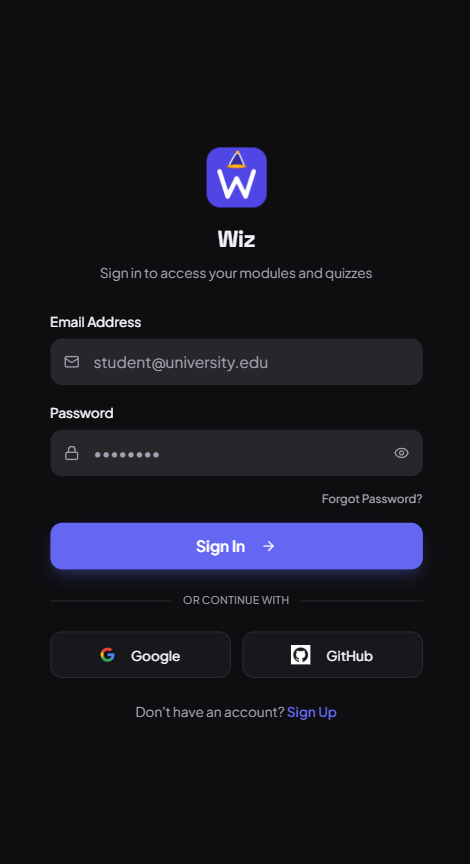

### Manual quiz builder — lets educators and students hand-craft quizzes question by question. Setting difficulty and question count upfront shapes the learning experience before content is added.

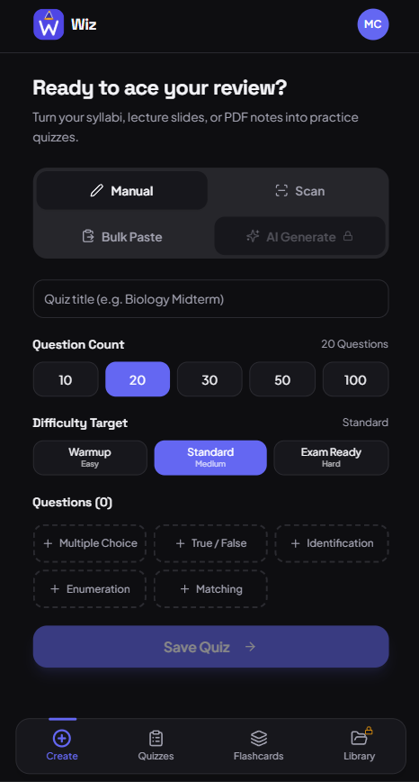

### Fresh account state — the empty dashboard shows zeroed stats to motivate new users. Seeing "0 completed" creates a psychological drive to take the first quiz and start filling the dashboard.

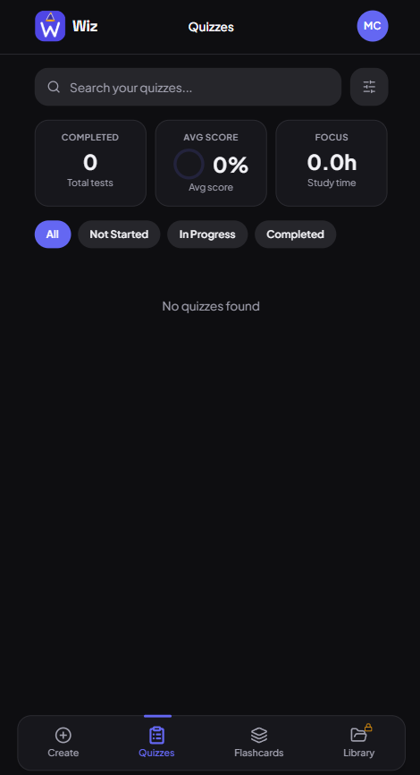

### Learner profile — tracks individual progress (flashcards mastered, day streak, mastery percentage) to gamify studying. Streaks leverage loss aversion: users return daily to avoid resetting their count.

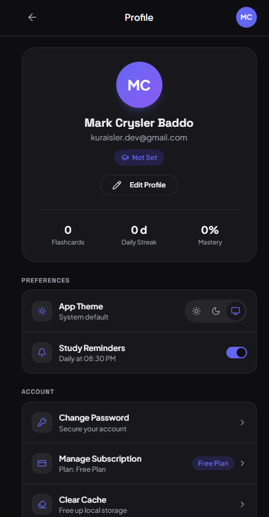

### Monetization page — presents the freemium tiers clearly. The Pro plan at ₱279/month unlocks unlimited AI generation and advanced features, converting power users into paying subscribers.

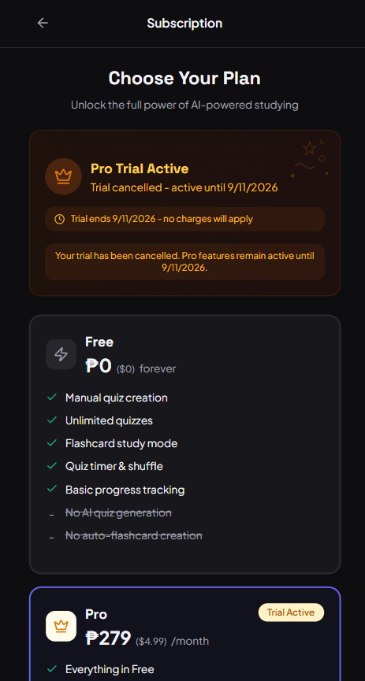

### Camera-to-quiz pipeline — students photograph textbook pages or lecture slides and Wiz converts them into quiz questions. Eliminates manual transcription of study material.

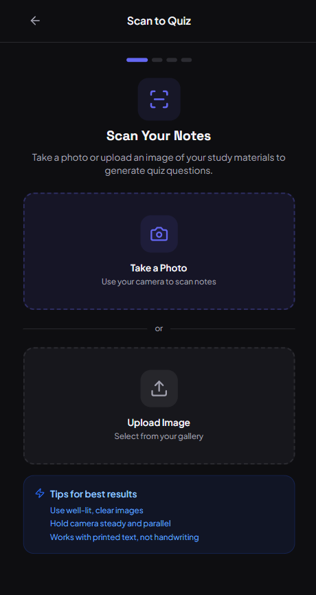

### Bulk paste importer — for students who already have questions in text form (from past exams, study guides, etc.). The format guide teaches the syntax so imports parse correctly.

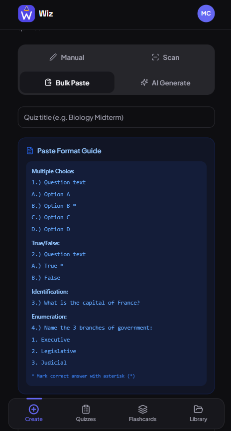

### AI generation setup — users upload their course materials (PDFs, DOCX) and Wiz's AI reads them to auto-generate relevant quiz questions. This is the platform's core value proposition.

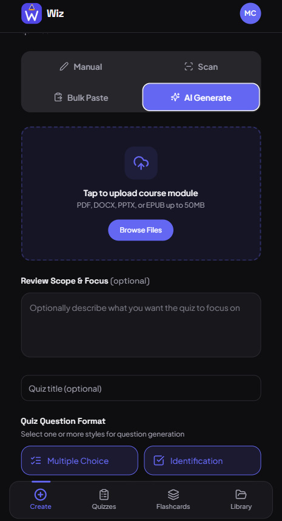

### Generation confirmation — shows the uploaded file is ready, lets users name the quiz and choose question count/difficulty, then confirms successful generation with a toast notification.

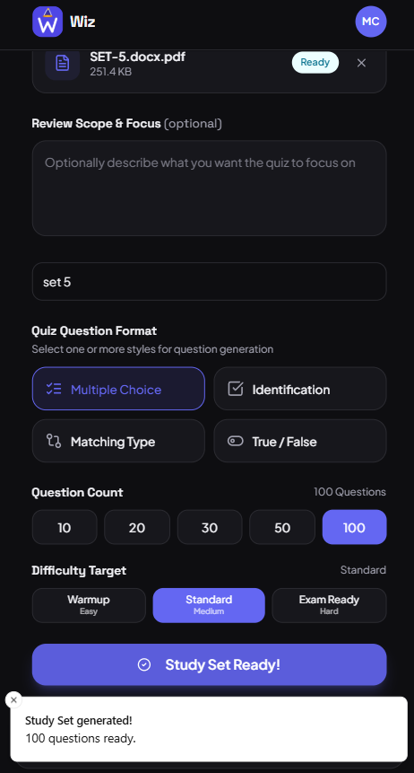

### Quiz library — the student's personal dashboard of all created quizzes with status indicators (Not Taken, needs review) and aggregate performance stats. The central hub for ongoing study.

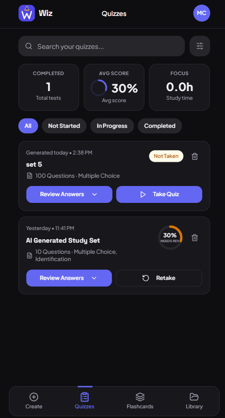

### Pre-quiz configuration — lets students customize each quiz attempt: time limit, shuffle order, and question selection. Shuffling prevents memorization of answer positions across retakes.

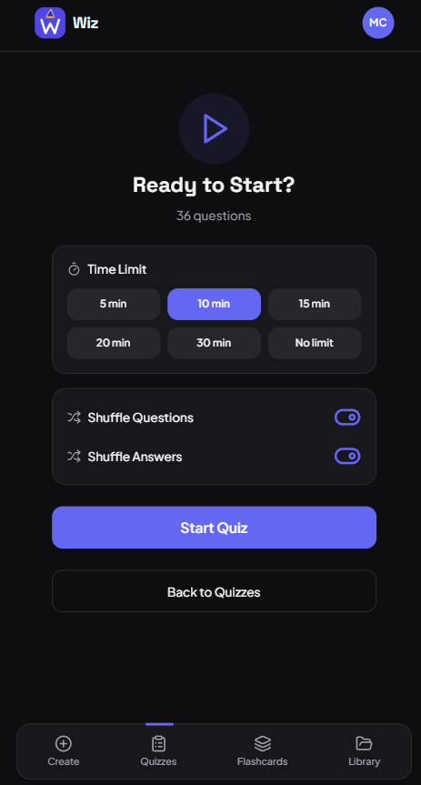

### Active testing environment — the timed quiz interface with question navigation, answer selection, and countdown timer. The pressure of the clock simulates real exam conditions.

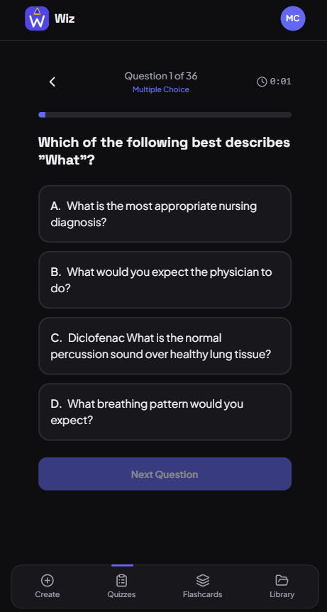

### Results & review — immediately after submission, students see their score, time taken, and a question-by-question breakdown with correct/incorrect indicators. The review loop is where actual learning happens.

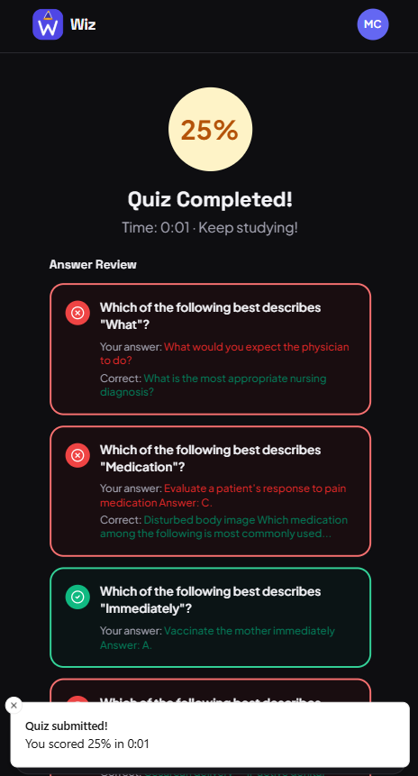

### Spaced repetition flashcards — cards flip on tap with shuffle, hint, and star (favorite) controls. Mastery percentage tracks long-term retention, not just one-time quiz scores.

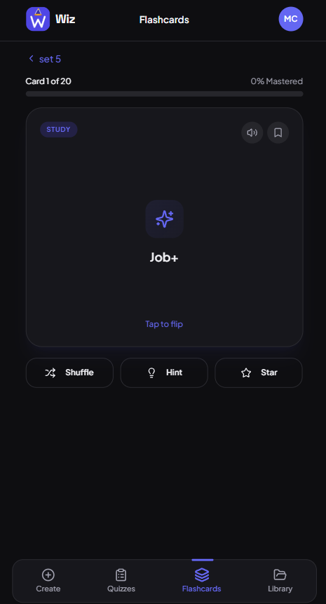

## Features

- Create quizzes manually, by bulk paste, by photo scan, or via AI generation
- Upload course documents and auto-generate questions
- Timed quizzes with shuffle and instant results
- Answer review with correct/incorrect feedback
- Flashcard study mode with mastery tracking
- Profile with streak, mastery stats, and subscription plans

## Tech Stack

- React
- Vite
- Tailwind CSS
- Supabase
- OpenAI API

## About

A full-featured study platform that lets students create quizzes from photos, pasted text, or AI-generated content from uploaded course materials. Includes timed testing, flashcards, performance analytics, and a freemium subscription model.

---

Built by [Mark Crysler Baddo](https://github.com/Kuraisura) · [Portfolio](https://kuraisler.xyz)
